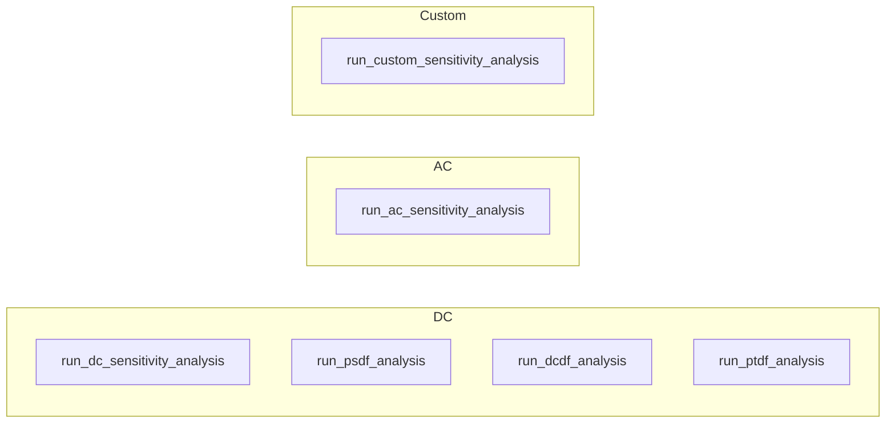

### Tools Reference

This document lists all MCP tools exposed by the PyPowsybl MCP server, grouped by category.

---

#### I/O tools

| Tool                     | Description                                                                                                    |
|--------------------------|----------------------------------------------------------------------------------------------------------------|
| `load_network_from_file` | Load a power network from a local file path (XIIDM, Matpower, CGMES, …).                                       |
| `load_network_from_url`  | Download and load a network from a remote URL (SSL verification is configured globally with `MCP_VERIFY_SSL`). |
| `get_import_options`     | List the import formats, post-processors, server boundary sets and, for one format, its importer parameters.  |
| `export_network`         | Export the current (or a named) network to a file; returns a temporary download link.                          |

PowSyBl picks the importer from the file extension, so when `load_network_from_url` is given a URL without one it reads
(`…/download?id=42`), the downloaded file is named after its content: `.zip`, `.xml` (XIIDM or CGMES, each importer
checks the content itself), `.jiidm` (JSON) or `.mat` (MATPOWER).

Both loading tools take the same import options:

| Argument          | Description                                                                                                       |
|-------------------|-------------------------------------------------------------------------------------------------------------------|
| `parameters`      | Importer parameters by full name, e.g. `{"iidm.import.cgmes.naming-strategy": "cgmes"}`. An unknown name is refused: PowSyBl itself would ignore it silently and load the file without the option. A known name of another format (a CGMES parameter for an XIIDM file) loads, with a warning in the answer. |
| `post_processors` | Post-processors to run, CGMES ones (`EntsoeCategory`, `cgmesDLImport`, …) and generic ones (`geoJsonImporter`, …) in one list. `EntsoeCategory` only tags the generating units whose CGMES type maps to an ENTSO-E category, possibly none. |
| `boundary_set`    | Name of a CGMES boundary set the server provides (a directory or `.zip` in `CGMES_BOUNDARY_SETS_DIR`, see the [Configuration Reference](configuration.md)). |
| `boundary_url`    | URL of a CGMES boundary set to download: a `.zip`, or a single `.xml` only for a CGMES 3 boundary (EQBD alone). A CGMES 2.4.15 boundary needs both EQBD and TPBD, so it must come as a `.zip`. A download whose URL lacks the extension (`…/download?id=42`) is named after its content. Exclusive with `boundary_set`. |

`get_import_options` also says, as `default_boundary_set`, whether a CGMES load given no boundary set still finds one
at PowSyBl's default location (never the path itself), so a client can tell beforehand that a model depending on a
boundary set it does not ship would fail. `iidm.import.cgmes.boundary-location` cannot be passed as a parameter: it is
a path on the server's disk. Without a
boundary option, the boundary profiles can also sit in the CGMES archive itself, and the PowSyBl default location
applies otherwise. When the archive ships its own boundary profiles (told by their header profile, not their file
name), PowSyBl reads those and ignores the boundary set given: the answer then leaves `boundary` out and says so in
`warnings`. A CGMES load that fails for want of a boundary set says so. On success, the answer also gives the
`import_format` (the importer that read the file), the `source_format` (the format the network first came from: an
IIDM file keeps its origin's), the options applied and, if any, `warnings` listing those the importer ignored.

---

#### Network tools

##### Network lifecycle

| Tool                  | Description                                                                     |
|-----------------------|---------------------------------------------------------------------------------|
| `create_ieee_network` | Create a standard IEEE test network (IEEE14, IEEE30, IEEE57, IEEE118, IEEE300). |
| `list_networks`       | List all networks currently loaded in the session.                              |
| `switch_network`      | Set a loaded network as the active one for subsequent operations.               |
| `remove_network`      | Remove a network from the session cache.                                        |
| `get_network_info`    | Return metadata about the current (or a named) network.                         |

##### Network inspection

| Tool                                 | Description                                                                 |
|--------------------------------------|-----------------------------------------------------------------------------|
| `get_network_element_data`           | Return tabular data for a given element type (buses, lines, generators, …); pass `conditions` to filter, `attach` to enrich, `get_only_ids=True` for just the element IDs. |
| `compare_variants`                   | Diff one element type's table between two variants (added/removed/changed); scope with variant-independent `conditions`. |
| `get_top_active_power_transit_lines` | Return the lines with the highest active power transit.                     |
| `check_voltage_violations`           | List buses whose voltage is outside acceptable bounds (N state).            |
| `check_current_violations`           | List branches loaded above a threshold in the N state (line + 2WT, worst first). |

`get_network_element_data`'s `attach` tokens: `current_limits`, `geotags`, `voltage_limits`, and three that read IIDM
extensions — `load_detail` (fixed and variable part of each load: `fixed_p0`, `variable_p0`, `fixed_q0`,
`variable_q0`), `entsoe_category` (`entsoe_category_code` of the generators tagged by the `EntsoeCategory` CGMES
post-processor) and `extension:<name>` (any extension, columns named `<name>_<column>`). The joined columns can be used
in `conditions`; an element without the extension gets null. An extension not keyed by element id
(`cgmesMetadataModels`, keyed by model URN) or with several rows per element (`linePosition`) is refused: read it with
`get_network_extension_data`.

`get_network_element_data`, `check_voltage_violations`, `check_current_violations`, `compare_variants` and
`run_security_analysis` also take `return_as="artifact_json"` / `"artifact_csv"` to hand a large table over
as a file instead of inlining it — see [Returning a big result as a file](#returning-a-big-result-as-a-file).

##### Network extensions (IIDM)

| Tool                         | Description                                                                                     |
|------------------------------|-------------------------------------------------------------------------------------------------|
| `list_network_extensions`    | List the IIDM extensions the network carries (`detail`, `entsoeCategory`, …), with their counts and columns. |
| `get_network_extension_data` | Read one extension as a table indexed by element id; filter on `ids`, paginate, or return it as a file. |

##### Network modification

| Tool                 | Description                                                                       |
|----------------------|-----------------------------------------------------------------------------------|
| `modify_network`     | Change parameters (P, Q, target voltage, …) of one or more network elements.      |
| `set_line_status`    | Connect or disconnect a branch (line or transformer).                             |
| `set_switch_status`  | Open or close a switch in the network (breaker, disconnector, load-break switch). |
| `set_tap_position`   | Move a transformer's ratio or phase tap changer to a new position.                |

##### Network extension and reduction

Creating and removing elements (`describe_element_creation`, `create_network_element`, `create_network_elements`,
`remove_network_elements`) is provided by the **grid-extension plugin**, shipped in this repository and active by
default: see [grid_extension.md](grid_extension.md). Turn it off with
`MCP_DISABLED_PLUGINS=grid_extension`.

##### Variants

| Tool                  | Description                                         |
|-----------------------|-----------------------------------------------------|
| `clone_variant`       | Clone the current variant into a new named variant. |
| `set_working_variant` | Switch the active variant.                          |
| `get_working_variant` | Return the name of the currently active variant.    |
| `list_variants`       | List all variants of the current network.           |
| `remove_variant`      | Delete a named variant.                             |

---

#### Visualization tools

| Tool                                  | Description                                                                     |
|---------------------------------------|---------------------------------------------------------------------------------|
| `plot_substation_single_line_diagram` | Generate a single-line diagram (SLD) for a substation; returns a download link. |
| `visualize_network`                   | Generate a network area diagram; returns a download link.                       |

---

#### Load flow tools

| Tool                             | Description                                                                                                |
|----------------------------------|------------------------------------------------------------------------------------------------------------|
| `run_loadflow`                   | Run an AC or DC load flow on the current network.                                                          |
| `get_loadflow_params`            | Return the current load flow parameters.                                                                   |
| `update_loadflow_params`         | Update one or more load flow parameters for the session, once the session's provider has checked them.     |
| `restore_default_loadflow_param` | Reset load flow parameters to the values in `LF_default_parameters.toml`.                                  |
| `get_loadflow_provider_info`     | List all available load flow providers, the system default, and the provider active in the session.        |
| `set_loadflow_provider`          | Switch the load flow provider for the current session; pass an empty string to restore the system default. |

---

#### Security analysis tools

| Tool                        | Description                                                                  |
|-----------------------------|------------------------------------------------------------------------------|
| `run_security_analysis`     | Run N-1 (or N-k) security analysis using a contingency list; pass `threshold_percent` (with `limit_type="CURRENT"`) to keep only overloads. |
| `create_contingencies_list` | Automatically generate a contingency list from the current network topology. |

---

#### Sensitivity analysis tools

| Tool                              | Description                                                                       |
|-----------------------------------|-----------------------------------------------------------------------------------|
| `run_dc_sensitivity_analysis`     | DC sensitivity of branch flows to injections or PST angles.                       |
| `run_ac_sensitivity_analysis`     | AC sensitivity of branch flows or bus voltages to injections or transformer taps. |
| `run_psdf_analysis`               | Phase-Shifter Distribution Factors for all branches.                              |
| `run_dcdf_analysis`               | DC Distribution Factors for a set of branches and injections.                     |
| `run_ptdf_analysis`               | Power Transfer Distribution Factors between bidding zones.                        |
| `run_custom_sensitivity_analysis` | Run a fully custom sensitivity analysis with user-defined factors.                |

---

#### Session tools *(admin, token-protected)*

| Tool                    | Description                                                                  |
|-------------------------|------------------------------------------------------------------------------|
| `get_pypowsybl_version` | Get the version of the pypowsybl library being used by the MCP server.       |
| `set_session_id`        | Override the session ID for the current MCP connection.                      |
| `duplicate_session`     | Deep-copy the proxy state from one session to another (fork a conversation). |

These tools (except `get_pypowsybl_version`) are protected by `MCP_AUTH_TOKEN` and **must never be called directly by an
LLM**.

---

#### Code export tools

| Tool                     | Description                                                                                                                                            |
|--------------------------|--------------------------------------------------------------------------------------------------------------------------------------------------------|
| `generate_python_script` | Generate a standalone `pypowsybl` Python script reproducing the operations performed in the session. Uses an LLM sub-agent; requires `OPENAI_API_KEY`. |

---

#### Resource tools

| Tool                  | Description                                                                                                |
|-----------------------|-------------------------------------------------------------------------------------------------------------|
| `get_online_resource` | Fetch `pypowsybl` API reference documentation (from readthedocs) for a class or method; caches it server-side. |
| `read_resource`       | Read back a documentation page already fetched this session with `get_online_resource`, from the cache.   |

---

#### Returning a big result as a file

Read tools that can produce a large table — `get_network_element_data`, `check_voltage_violations`,
`check_current_violations`, `compare_variants` and `run_security_analysis` — accept
`return_as="artifact_json"` or `return_as="artifact_csv"` (default `"inline"`). Instead of inlining the
rows, the server writes them to a temporary file and answers with the summary counts, the column list, a
short preview and a download URL. Nothing is truncated, and the full table is fetched over plain HTTP by
whoever needs it rather than travelling through the client's context.

The format is carried in `return_as` itself — `artifact_json` for JSON, `artifact_csv` for CSV. There is no
separate `artifact_format` argument.

#### Notes

- All tools return a **string** (plain text or JSON-formatted text).
- Tools that produce files (diagrams, exports) return a **temporary download URL** of the form
  `http://<MCP_PUBLIC_ADDRESS>:<MCP_PORT>/download/<token>/<filename>`.
- The `ctx` parameter is injected automatically by MCPServer and must not be passed by the caller.
- This page lists the server's **built-in** tools only. Installed plugins can add further tools that appear
  alongside these in the same tool list — see [plugins.md](plugins.md).
